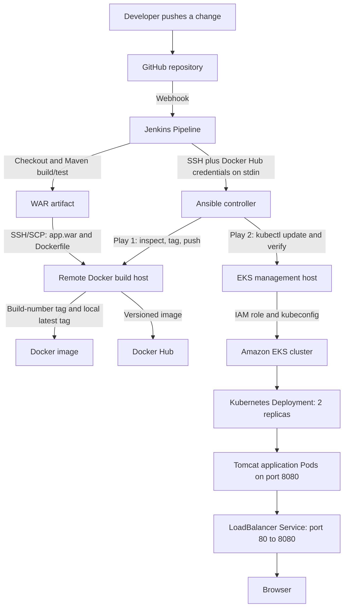

# Java CI/CD Pipeline on Amazon EKS

A learning project that automates delivery of a Java web application to Amazon EKS. Jenkins builds and tests the Maven application, packages a WAR, builds a Docker image on a remote host, and invokes Ansible to publish a versioned image and roll it out to Kubernetes.

> This repository is based on an upstream Java sample. The application interface is a demonstration; its login form is not backed by an authentication service. AWS resources, Jenkins credentials, Docker Hub access, and host addresses must be configured by each user.

## Architecture

### End-to-end architecture



### What each component does

| Component | Responsibility |
| --- | --- |
| **GitHub** | Stores the application and pipeline source. A push to the configured branch triggers Jenkins through a webhook. |
| **Jenkins** | Checks out the configured SCM, verifies Java/Maven, builds and tests the Maven project, archives the WAR, transfers build inputs, builds the Docker image remotely, and starts Ansible deployment. |
| **Docker build host** | Receives the WAR as `app.war` and the Dockerfile over SSH/SCP. Docker builds `hello-world:<BUILD_NUMBER>` and a local `hello-world:latest` tag. |
| **Ansible controller** | Receives the Docker Hub username and token from Jenkins over SSH standard input, then runs the two deployment plays using its inventory. |
| **Docker host Ansible target** | Verifies the Jenkins-built image, creates temporary Docker auth configuration, logs in with `--password-stdin`, tags the image for Docker Hub, pushes the build-number tag, and removes temporary auth files. |
| **EKS management host** | Uses its attached AWS IAM role and configured kubeconfig to reach the cluster. Ansible updates the Deployment image and verifies the rollout. This is an administration host, not the Kubernetes control plane. |
| **Amazon EKS** | Runs the managed Kubernetes control plane and worker nodes. The Deployment keeps two application replicas available during rolling updates. |
| **LoadBalancer Service** | Exposes HTTP on port 80 and routes to application containers on port 8080. AWS creates the load balancer; its generated hostname is intentionally not stored here. |

### Pipeline stages in detail

1. **Webhook and checkout:** GitHub notifies Jenkins after a push. Jenkins checks out the SCM configured on the job and records the commit.
2. **Build and test:** Jenkins uses the configured Java 21 and Maven 3.10.0 tools and runs `mvn -B -ntp clean package`. The Maven reactor contains the `server` and `webapp` modules; the WAR is generated at `webapp/target/webapp.war`.
3. **Artifact archive:** Jenkins verifies that a WAR exists, archives it, and fingerprints the artifact for traceability.
4. **Transfer to Docker host:** Jenkins uses its SSH credential to copy the WAR and Dockerfile to the remote build host. The WAR is named `app.war`, matching the Dockerfile's `COPY app.war` instruction.
5. **Image build:** The Docker host builds the image from the Tomcat base image in the Dockerfile. It tags the local image with the Jenkins build number and `latest`. The Ansible playbook publishes the versioned tag; it does not push the `latest` tag.
6. **Publish image:** Jenkins invokes Ansible on its controller host. The controller runs Play 1 against the Docker host, verifies the local image, authenticates to Docker Hub using the token from standard input, tags the image as `<DOCKERHUB_NAMESPACE>/hello-world:<BUILD_NUMBER>`, and pushes it.
7. **Deploy to EKS:** Ansible runs Play 2 against the EKS management host. It checks cluster connectivity, updates `hello-world-deployment` to the new image, waits for rollout completion, and verifies two ready replicas.
8. **Serve traffic:** The Kubernetes Service selects pods labeled `app=hello-world`, accepts traffic on port 80, and forwards it to Tomcat on port 8080.

### Kubernetes workload

The Deployment runs two `hello-world-container` replicas in the `default` namespace. Its rolling update strategy sets `maxSurge: 1` and `maxUnavailable: 0`. A TCP readiness probe checks port 8080 after a 10-second initial delay and every 10 seconds. Each pod requests 100m CPU and 256Mi memory, with limits of 500m CPU and 512Mi memory.

The Service is type `LoadBalancer`, uses the same `app=hello-world` selector, and maps TCP port 80 to target port 8080. A cloud load balancer may continue to incur AWS charges until the Service is deleted.

### EKS cluster lifecycle

Cluster provisioning is separate from the Jenkins application pipeline. The sanitized `eks/cluster.example.yaml` documents the `eksctl` configuration: a managed `t3.medium` node group, 20 GiB worker volumes, an initial desired size of zero, and scaling bounds of zero to three. The project scaled the node group to two workers before deploying the application. Scaling workers to zero does not remove the EKS control plane, NAT Gateway, management host, or every networking resource.

### Image tag flow

```text
Jenkins build N
  Docker host: hello-world:N and hello-world:latest (local tags)
  Docker Hub:  <DOCKERHUB_NAMESPACE>/hello-world:N
  EKS:         Deployment updated to <DOCKERHUB_NAMESPACE>/hello-world:N
```

The build-number tag connects a running deployment to a specific Jenkins build. The Docker Hub namespace is a placeholder in this public repository; configure the real repository in Jenkins Credentials/job settings.

## Technology

Java 21 · Maven 3.10.0 · Jenkins · Docker · Ansible · Docker Hub · Kubernetes · Amazon EKS · AWS IAM · eksctl

## Repository structure

```text
.
├── .gitignore
├── Dockerfile
├── Jenkinsfile
├── README.md
├── pom.xml
├── ansible/
│   ├── README.md
│   ├── ansible.cfg
│   ├── deploy.yml
│   └── inventory.example.ini
├── docs/
│   ├── architecture.md
│   ├── eks-and-kubernetes.md
│   ├── pipeline-and-automation.md
│   ├── security-and-secrets.md
│   └── setup-guide.md
├── eks/
│   ├── README.md
│   └── cluster.example.yaml
├── kubernetes/
│   ├── README.md
│   ├── deployment.yaml
│   └── service.yaml
├── server/
│   ├── pom.xml
│   └── src/
│       ├── main/java/com/example/Greeter.java
│       ├── site/apt/index.apt
│       └── test/java/com/example/TestGreeter.java
└── webapp/
    ├── pom.xml
    └── src/main/webapp/
        ├── index.jsp
        └── WEB-INF/web.xml
```

### What the files do

| Path | Purpose |
| --- | --- |
| `README.md` | Project overview, architecture, build instructions, and this file map. |
| `.gitignore` | Excludes Maven build output, local inventories, kubeconfig, private keys, environment files, and editor/OS files. |
| `pom.xml` | Parent Maven project. It builds the `server` and `webapp` modules together. |
| `Jenkinsfile` | Pipeline example: checks out the Jenkins job's SCM, builds/tests the WAR, transfers it to the Docker host, builds the image, and starts Ansible deployment. Fill the host and Docker Hub placeholders in Jenkins configuration before running it. |
| `Dockerfile` | Packages `app.war` into the Tomcat image and serves it on container port 8080. Jenkins transfers the Maven WAR using that expected filename. |
| `ansible/ansible.cfg` | Ansible defaults, including the private runtime inventory path, SSH host-key checking, timeout, and SSH connection settings. |
| `ansible/inventory.example.ini` | Safe inventory template for the Docker build host and EKS management host. Copy it to a private `inventory.ini` and fill in local connection details; do not commit that real inventory. |
| `ansible/deploy.yml` | Two plays: publish the versioned image from the Docker host, then update the Kubernetes Deployment from the EKS management host and verify rollout/readiness. |
| `ansible/README.md` | Ansible prerequisites, inventory setup, credential flow, and Jenkins invocation notes. |
| `kubernetes/deployment.yaml` | Two-replica application Deployment, rolling-update policy, readiness probe, and CPU/memory requests and limits. Its Docker Hub namespace is a placeholder. |
| `kubernetes/service.yaml` | Public `LoadBalancer` Service mapping port 80 to the application on port 8080. Its generated AWS endpoint is intentionally not checked in. |
| `kubernetes/README.md` | How to configure, apply, and inspect the Kubernetes manifests, with a note about load-balancer costs. |
| `eks/cluster.example.yaml` | Sanitized `eksctl` ClusterConfig example for a managed worker group. Replace the cluster and AWS region placeholders before use. |
| `eks/README.md` | EKS creation, connection, node scaling, IAM, and cost/cleanup guidance. |
| `docs/architecture.md` | Component diagram and responsibilities across Jenkins, Docker, Ansible, and EKS. |
| `docs/pipeline-and-automation.md` | Jenkins stages and the two Ansible plays in execution order. |
| `docs/setup-guide.md` | Prerequisites and setup sequence for Jenkins, Ansible, Docker, and EKS. |
| `docs/eks-and-kubernetes.md` | Cluster configuration, workload behavior, rollout checks, and AWS cost notes. |
| `docs/security-and-secrets.md` | Secret handling, sanitization rules, and security review findings. |
| `server/` | Maven Java module containing the greeting class, unit tests, and Maven site source. |
| `server/src/main/java/com/example/Greeter.java` | Small application logic class used by the Java module. |
| `server/src/test/java/com/example/TestGreeter.java` | Unit tests for the greeting behavior. |
| `webapp/` | Maven WAR module containing the JSP application interface and deployment descriptor. |
| `webapp/src/main/webapp/index.jsp` | Demo web page packaged into the WAR. Its login form is visual only; the repository does not implement authentication. |
| `webapp/src/main/webapp/WEB-INF/web.xml` | Web application descriptor packaged with the WAR. |

Maven's generated `target/` directories and the real Ansible inventory are local/runtime files, so they are intentionally absent from the tree above.

See [architecture](docs/architecture.md), [pipeline and automation](docs/pipeline-and-automation.md), [setup guide](docs/setup-guide.md), [EKS and Kubernetes](docs/eks-and-kubernetes.md), and [security notes](docs/security-and-secrets.md).

## Build locally

The Maven project contains `server` and `webapp` modules. The WAR module produces `webapp/target/webapp.war`.

```bash
mvn -B -ntp clean package
```

Jenkins transfers the generated WAR to the Docker host as `app.war`, matching the Dockerfile input.

## Pipeline and deployment

The Jenkinsfile checks out the SCM configured on the Jenkins job. Configure its GitHub webhook and Jenkins tools/credentials in Jenkins itself. Replace the clearly marked host and Docker Hub placeholders before running it. The Ansible example uses a private `inventory.ini` at runtime; only `inventory.example.ini` belongs in the public repository.

The EKS Deployment runs two replicas with a TCP readiness probe on port 8080. The Service exposes port 80 and targets port 8080. A cloud LoadBalancer may incur ongoing charges; the generated endpoint is intentionally not stored here.

## Security

No real credentials, private addresses, personal usernames, or private key paths belong in this repository. Store secrets in Jenkins Credentials and AWS IAM roles. Review [security and secrets](docs/security-and-secrets.md) before adapting the examples.

## Attribution and license

The Java application originated from the [upstream sample project](https://github.com/yankils/hello-world). This repository does not add a license because the upstream reuse terms need to be confirmed first; retain the upstream attribution and check those terms before redistributing inherited code.
