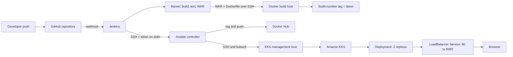

# Architecture

## End-to-end delivery



## Hosts and responsibilities

| Component | Responsibility |
| --- | --- |
| Jenkins | Checks out `master`, verifies Java/Maven, builds and archives the WAR, transfers build inputs, and starts the Ansible deployment |
| Docker build host | Receives `app.war` and `Dockerfile`; builds the `hello-world` image with a build-number tag and `latest` |
| Ansible controller | Receives Docker Hub token through encrypted SSH standard input and runs `deploy.yml` using `inventory.ini` |
| Docker host inventory target | Verifies the local image, tags it for Docker Hub, authenticates, and pushes the build-number tag |
| EKS management host | Uses its AWS IAM role and kubeconfig to run `kubectl` against the EKS cluster and verify the rollout |
| Amazon EKS | Runs the managed Kubernetes control plane and application worker nodes |

The Ansible controller and EKS management host are separate roles. The inventory names the EKS management host as `eks_host`; it is not an EKS control-plane node.

## Application traffic

```text
Internet → AWS LoadBalancer → Kubernetes Service :80
         → hello-world Pods :8080 (2 replicas)
```

The Service selects pods with `app=hello-world`. The Deployment uses `maxSurge: 1` and `maxUnavailable: 0`, so the rollout can add one pod while keeping the existing availability target.

## Observed project details

- AWS region: generalized in the public docs as `<AWS_REGION>`.
- EKS cluster and node group names: generalized as `<EKS_CLUSTER_NAME>` and `<NODE_GROUP_NAME>`.
- Node group: managed group, `t3.medium`, 20 GiB volume, zero initial nodes, autoscaling bounds 0–3; scaled to two nodes for deployment.
- Kubernetes authentication: EKS management host uses an EC2 IAM role and a user-specific kubeconfig.
- Application image: `<DOCKERHUB_NAMESPACE>/hello-world:<BUILD_NUMBER>`.
- The `kubernetes/` manifests capture the Deployment and Service used by the project.

